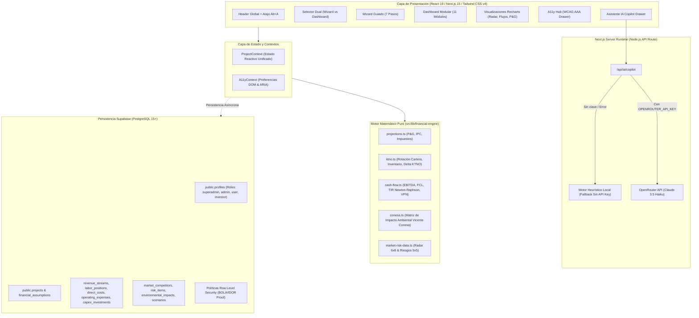

# 📊 Matriz de Negocios — Plataforma de Evaluación Financiera & Factibilidad Multicriterio

> **Transformación digital del modelo metodológico de Jorge Orozco en un SaaS financiero interactivo de alto rendimiento, accesible (WCAG AAA) y potenciado por IA.**

[](https://nextjs.org/)
[](https://react.dev/)
[](https://www.typescriptlang.org/)
[](https://tailwindcss.com/)
[](https://supabase.com/)
[](https://vitest.dev/)
[](https://www.w3.org/WAI/standards-guidelines/wcag/)

---

## 📑 Tabla de Contenidos

1. [Descripción General](#-descripción-general)
2. [Arquitectura del Sistema](#-arquitectura-del-sistema)
3. [Características Clave](#-características-clave)
   - [Motor Financiero Matemático en Tiempo Real](#1-motor-financiero-matemático-en-tiempo-real)
   - [Hub de Accesibilidad Universal (WCAG AAA)](#2-hub-de-accesibilidad-universal-a11y-hub--wcag-aaa)
   - [Navegación Dual: Wizard Guiado vs. Dashboard Modular](#3-navegación-dual-wizard-guiado-vs-dashboard-modular)
   - [Módulos Cualitativos & Multicriterio](#4-módulos-cualitativos--multicriterio)
   - [Exportación de Dossier Ejecutivo en PDF](#5-exportación-de-dossier-ejecutivo-en-pdf)
   - [Asistente IA Copilot con Tolerancia a Fallos](#6-asistente-ia-copilot-con-tolerancia-a-fallos)
   - [Seguridad, Roles y Políticas RLS en Supabase](#7-seguridad-roles-y-políticas-rls-en-supabase)
4. [Matriz de Equivalencias (Excel Original vs. Aplicación Web)](#-matriz-de-equivalencias-excel-original-vs-aplicación-web)
5. [Guía de Inicio Rápido](#-guía-de-inicio-rápido)
6. [Variables de Entorno](#-variables-de-entorno)
7. [Despliegue de Base de Datos & Migraciones](#-despliegue-de-base-de-datos--migraciones)
8. [Estructura del Proyecto](#-estructura-del-proyecto)
9. [Suite de Pruebas Automatizadas](#-suite-de-pruebas-automatizadas)
10. [Licencia y Reconocimientos](#-licencia-y-reconocimientos)

---

## 🌟 Descripción General

**Matriz de Negocios** traslada el modelo clásico de evaluación financiera de proyectos en hoja de cálculo formulada (`Formato para evaluación de proyectos(Jorge_Orozco).xlsm`) a una aplicación web moderna, reactiva, accesible y de grado corporativo. 

El caso de estudio insignia implementado corresponde al proyecto de una **Agencia de Creación y Monetización de Contenidos Digitales y Afiliados en Popayán, Cauca** (constituida bajo el tipo societario **S.A.S.**, código **CIIU J5911**).

### Objetivos Principales
- **Precisión Matemática Absoluta:** Replicación idéntica al céntimo de las fórmulas financieras de Microsoft Excel para Estados de Resultados (P&G), Capital de Trabajo Neto Operativo (KTNO), Flujo de Caja Libre (FCL), Tasa Interna de Retorno (TIR) y Valor Presente Neto (VPN estándar y VPN Excel).
- **Inclusión Universal:** Diseño concebido desde su concepción bajo los lineamientos de accesibilidad web **WCAG 2.1 / 2.2 Nivel AAA**, ofreciendo compatibilidad plena con lectores de pantalla, modos de alto contraste, tipografías para dislexia, reducción de movimiento y atajos de teclado globales.
- **Experiencia de Usuario Flexible:** Paradigma de interacción dual que permite alternar entre un **Asistente Guiado Paso a Paso (Wizard)** de 7 etapas y un **Dashboard Libre y Modular** con 11 paneles especializados.
- **Resiliencia Operativa:** Integración opcional de Inteligencia Artificial mediante OpenRouter con conmutación por error (*graceful fallback*) a un motor determinista basado en reglas si la API no está configurada o se encuentra fuera de línea.

---

## 🏗 Arquitectura del Sistema

La solución adopta la arquitectura moderna de **Next.js 15 con React 19**, desacoplando el cálculo financiero en un motor matemático en TypeScript puro que corre de forma determinista y sin latencia en el navegador del cliente, mientras que la persistencia y autenticación se delegan a **Supabase PostgreSQL** blindado con **Row Level Security (RLS)**.



### Componentes Tecnológicos
- **Framework Web:** [Next.js 15.2.0](https://nextjs.org/) con App Router y React 19.
- **Tipado Estático:** [TypeScript 5](https://www.typescriptlang.org/) en modo estricto (`strict: true`).
- **Diseño & Estilos:** [Tailwind CSS v4](https://tailwindcss.com/) con `@tailwindcss/postcss` y soporte para variables CSS nativas de alto contraste.
- **Visualización de Datos:** [Recharts 3.10](https://recharts.org/) (gráficos de área, radar multicapa y barras interactivas).
- **Iconografía:** [Lucide React](https://lucide.dev/).
- **Base de Datos & Auth:** [Supabase SSR 0.12](https://supabase.com/docs/guides/ssr) y `@supabase/supabase-js 2.118`.
- **Inteligencia Artificial:** [OpenRouter](https://openrouter.ai/) con el modelo `anthropic/claude-3.5-haiku` y arquitectura de respaldo determinista.
- **Testing:** [Vitest 5.0](https://vitest.dev/) con suite completa de pruebas unitarias y de integración cruzada contra Excel.

---

## ⚡ Características Clave

### 1. Motor Financiero Matemático en Tiempo Real
Ubicado en `src/lib/financial-engine/`, este motor ejecuta proyecciones a 5 años sin recargar la página:
- **Estado de Resultados (P&G):** Proyección de ventas con crecimiento anual indexado por inflación (IPC), cálculo de costo directo (mano de obra y materiales), gastos operacionales (OPEX), depreciación lineal y liquidación de impuesto sobre la renta (32%, 31%, 30%).
- **Capital de Trabajo Neto Operativo (KTNO):** 
  $$\text{KTNO} = \text{CxC} + \text{Inventarios} - \text{CxP}$$
  Cálculo de la rotación en días y la **Variación de KTNO ($\Delta KTNO$)** que afecta directamente la liquidez del flujo de caja.
- **Flujo de Caja Libre (FCL):**
  $$\text{FCL} = \text{EBITDA} - \text{Impuestos} - \text{CAPEX} - \Delta \text{KTNO}$$
- **Tasa Interna de Retorno (TIR):** Resuelta con algoritmo numérico de alta precisión (Newton-Raphson) con tasa base de convergencia.
- **Valor Presente Neto (VPN):** 
  - VPN Financiero Estándar.
  - VPN compatible con la función `=VNA(tasa, flujo1:flujo5) + flujo0` de Microsoft Excel.
- **Dictamen de Viabilidad Automático:** Comprobación formal basada en las reglas: $\text{TIR} \ge \text{WACC}$ y $\text{VPN} > 0$.

### 2. Hub de Accesibilidad Universal (A11y Hub — WCAG AAA)
Implementado en `src/context/A11yContext.tsx` y `src/components/a11y/A11yHub.tsx`:
- **Atajo Global de Teclado:** Presiona `Alt + A` en cualquier momento para abrir/cerrar el panel de accesibilidad (`Escape` para cerrar). Trampa de foco (`focus trap`) para teclado completo.
- **Escalado Tipográfico:** Tamaños de fuente ajustables: Normal (100%), Grande (115%) y Extra Grande (130%).
- **Alto Contraste WCAG AAA:** Ratios de luminancia mayores a 7:1 en fondos, bordes y textos tanto para temas claros como oscuros.
- **Tipografía para Dislexia:** Activación dinámica de familias tipográficas con mayor espaciado interlineal y kerning diferenciado (`OpenDyslexic` y alternativas con licenciamiento libre).
- **Reducción Estricta de Movimiento:** Inhibe todas las transiciones y animaciones (`prefers-reduced-motion: reduce`) para usuarios propensos a fatiga visual o mareos vestibulares.
- **Región Viva (`aria-live="polite"`):** Notificaciones audibles para lectores de pantalla cada vez que se modifica un parámetro o ajuste visual.

### 3. Navegación Dual: Wizard Guiado vs. Dashboard Modular
El usuario puede alternar instantáneamente entre dos modos de trabajo sin perder su información:
1. **Asistente Guiado (Wizard de 7 Pasos):**
   - **Paso 1: Identidad:** Nombre del proyecto, razón social, tipo societario (S.A.S.) y código CIIU.
   - **Paso 2: Ingresos:** Catálogo de productos/servicios, precios unitarios y cantidades mensuales.
   - **Paso 3: Nómina Colombiana:** Configuración de SMLMV, auxilio de transporte y cálculo detallado de prestaciones (Salud, Pensión, Prima, Cesantías, Intereses de Cesantías y Vacaciones).
   - **Paso 4: Inversiones CAPEX:** Activos de capital, vida útil (años) y valor de salvamento.
   - **Paso 5: Capital de Trabajo:** Días de cuentas por cobrar (CxC), cuentas por pagar (CxP) e inventarios.
   - **Paso 6: Matriz Ambiental:** Evaluación inicial según el método Vicente Conesa.
   - **Paso 7: Resultados & Viabilidad:** KPIs ejecutivos, gráficos de flujos y dictamen financiero.
2. **Dashboard Libre (11 Módulos Especializados):**
   - Resumen & KPIs ejecutivos.
   - Ingresos y Precios.
   - Nómina Colombiana.
   - Inversiones CAPEX.
   - Insumos directos & Gastos OPEX.
   - Capital de Trabajo (KTNO).
   - Estados Financieros Consolidados (P&G y Flujo de Caja Libre).
   - Estudio de Mercado (Radar Chart).
   - Matriz de Riesgos y Mapa de Calor 5x5.
   - Estudio Legal y Técnico.
   - Matriz Ambiental Vicente Conesa.

### 4. Módulos Cualitativos & Multicriterio
- **Estudio de Mercado (Radar Chart de 6 Competidores):** Permite calibrar a la empresa frente a 5 competidores clave en 6 factores estratégicos (Calidad, Precio, Servicio al cliente, Ubicación, Tecnología, Innovación) utilizando visualizaciones interactivas de Recharts.
- **Matriz de Riesgos & Mapa de Calor 5x5:** Evaluación de riesgos operacionales, tecnológicos y financieros basada en la matriz de probabilidad ($1$ a $5$) por impacto ($1$ a $5$), con categorización en 4 niveles de severidad (Bajo, Medio, Alto, Crítico) y vinculación de controles mitigantes.
- **Estudio Legal S.A.S. & Técnico:** Parámetros jurídicos bajo la Ley 1258 de 2008, objeto social de producción audiovisual y contenidos digitales (CIIU J5911), límite de facultades del Representante Legal (25 SMLMV), ubicación geográfica estratégica en Popayán y capacidad instalada de servidores y fibra óptica simétrica.
- **Matriz Ambiental Vicente Conesa:** Evaluación multicriterio de impactos ambientales mediante los 8 atributos reglamentarios:
  $$I = \pm [3(U) + 2(EX) + MO + PE + RV + MC + EF + PR]$$
  Donde:
  - $U$: Intensidad (1 a 12)
  - $EX$: Extensión (1 a 8)
  - $MO$: Momento (1 a 4)
  - $PE$: Persistencia (1 a 4)
  - $RV$: Reversibilidad (1 a 4)
  - $MC$: Recuperabilidad (1 a 8)
  - $EF$: Efecto (1 o 4)
  - $PR$: Periodicidad (1 a 4)
  - Clasificación del impacto: **Irrelevante** ($<25$), **Moderado** ($25$ a $50$), **Severo** ($50$ a $75$) y **Crítico** ($>75$).

### 5. Exportación de Dossier Ejecutivo en PDF
Mediante el componente `ExportReportModal`, el usuario puede previsualizar y generar un informe gerencial consolidado para inversionistas y comités de crédito:
- Incluye resumen ejecutivo, dictamen de viabilidad, indicadores macroeconómicos, flujo de caja libre a 5 años, resumen de riesgos y factibilidad ambiental.
- Reglas optimizadas de `@media print` en `src/app/globals.css` que ocultan cabeceras, menús y botones, imprimiendo un reporte limpio y nítido de alta definición en hojas estándar A4 / Carta o exportándolo directamente como archivo PDF desde el diálogo de impresión del navegador.

### 6. Asistente IA Copilot con Tolerancia a Fallos
Implementado en `src/app/api/ai/copilot/route.ts` y `src/components/ai/AiAssistantDrawer.tsx`:
- **Tres Rutinas Especializadas:** Auditoría de Viabilidad Financiera, Estrategias de Optimización de Márgenes y Generación de *Elevator Pitch* para inversionistas.
- **Integración con OpenRouter:** Utiliza el modelo `anthropic/claude-3.5-haiku` con timeout de 12 segundos y control de contexto financiero real.
- **Principio de Resiliencia (Graceful Fallback):** La API key es completamente **opcional**. Si la variable de entorno `OPENROUTER_API_KEY` no se define, está vacía o si OpenRouter presenta intermitencias, el sistema genera de forma transparente un análisis cuantitativo y cualitativo riguroso basado en reglas matemáticas y el contexto financiero exacto del proyecto, sin arrojar errores ni interrumpir la experiencia de usuario.

### 7. Seguridad, Roles y Políticas RLS en Supabase
El backend en Supabase PostgreSQL cuenta con seguridad reforzada contra ataques BOLA (Broken Object Level Authorization) e IDOR:
- **Matriz de Roles:** Definida mediante el enum `user_role` (`superadmin`, `admin`, `user`, `investor`).
- **Aprovisionamiento Automático:** Trigger PL/pgSQL `on_auth_user_created` que sincroniza automáticamente cada registro de `auth.users` hacia `public.profiles`.
- **Funciones de Seguridad Definer:** `public.is_superadmin()` y `public.has_role(user_id, role)`.
- **Políticas RLS en Todas las Tablas:** Cada entidad financiera (`projects`, `financial_assumptions`, `revenue_streams`, `labor_positions`, `direct_costs`, `operating_expenses`, `capex_investments`, `market_competitors`, `risk_items`, `environmental_impacts`, `scenarios`) valida estrictamente la autoría con `(SELECT auth.uid()) = user_id` tanto en cláusulas `USING` como `WITH CHECK`, habilitando bypass controlado exclusivamente para superadministradores.

---

## 🗺 Matriz de Equivalencias (Excel Original vs. Aplicación Web)

La siguiente tabla documenta la correspondencia punto por punto entre las 13 hojas de cálculo del archivo original `Formato para evaluación de proyectos(Jorge_Orozco).xlsm` y la arquitectura modular del SaaS web:

| # | Hoja Excel Original | Propósito en el Modelo de Jorge Orozco | Componente / Módulo en la Web | Módulo de Código Fuente |
|---|---|---|---|---|
| **1** | `Base` | Parámetros macroeconómicos, ingresos, nómina con prestaciones de ley, insumos, OPEX, CAPEX y días de KTNO. | `StepRevenue`, `StepPayroll`, `StepCapex`, `RevenueManager`, `PayrollManager`, `CapexManager`, `OpexManager`, `WorkingCapitalManager` | `src/lib/financial-engine/payroll.ts`<br>`src/lib/financial-engine/projections.ts` |
| **2** | `Proyección FCL` | Flujo de Caja Libre Año 0 al Año 5, cálculo de TIR (73.12%) y cálculo de VPN ($81,442,455.82 COP). | `FinancialTables` (Pestaña FCL), `CashFlowChart`, `ResultsKPIs` | `src/lib/financial-engine/cash-flow.ts` |
| **3** | `Proyección P&G` | Estado de Resultados proyectado a 5 años (IPC, Costos directos, Depreciación, Impuestos 32%-30%, Utilidad Neta). | `FinancialTables` (Pestaña P&G), `IncomeEvolutionChart` | `src/lib/financial-engine/projections.ts` |
| **4** | `Proyección Balance Apertura` | Balance General inicial, activos fijos netos, capital de trabajo requerido y estructura patrimonial. | `WorkingCapitalManager`, `StepWorkingCapital` | `src/lib/financial-engine/ktno.ts` |
| **5** | `Resultados` | Tablero ejecutivo de decisión con comparación TIR vs. WACC (10%) y dictamen de viabilidad ("VIABLE"). | `ResultsKPIs`, `StepResults`, `ExportReportModal` | `src/lib/financial-engine/index.ts` |
| **6** | `Matriz de Riesgo` | Matriz 5x5 de riesgos del negocio, evaluación de probabilidad x impacto y medidas de control. | `RiskManager` (con Heatmap visual 5x5 y semáforo de criticidad) | `src/lib/financial-engine/market-risk-data.ts`<br>`src/components/dashboard/RiskManager.tsx` |
| **7** | `Mercado` | Estudio de competidores del mercado objetivo y factores diferenciales. | `MarketManager`, `MarketRadarChart` | `src/lib/financial-engine/market-risk-data.ts`<br>`src/components/charts/MarketRadarChart.tsx` |
| **8** | `Criterios` | Definición de las 6 dimensiones de evaluación de competidores. | `MarketManager` (Selector y ponderación de criterios) | `src/lib/financial-engine/market-risk-data.ts` |
| **9** | `Matriz` | Calificación cuantitativa ponderada de 6 competidores simultáneos. | `MarketManager`, `MarketRadarChart` | `src/components/charts/MarketRadarChart.tsx` |
| **10** | `Ambiental` | Matriz de Impacto Ambiental Vicente Conesa con 8 atributos, cálculo de Importancia y categorización. | `EnvironmentalManager`, `StepEnvironmental` | `src/lib/financial-engine/conesa.ts`<br>`src/components/dashboard/EnvironmentalManager.tsx` |
| **11** | `Gráficas` | Visualización de evolución de ingresos, costos y flujos financieros. | `IncomeEvolutionChart`, `CashFlowChart`, `MarketRadarChart` | `src/components/charts/` |
| **12** | `Estudio Legal` | Tipo de sociedad S.A.S., código CIIU J5911, límites de representación legal y régimen contractual. | `LegalTechnicalSummary` (Sección Legal), `StepIdentity` | `src/components/dashboard/LegalTechnicalSummary.tsx` |
| **13** | `Estudio Tecnico` | Requerimientos de hardware, servidores, conectividad simétrica y localización física en Popayán. | `LegalTechnicalSummary` (Sección Técnica), `StepIdentity` | `src/components/dashboard/LegalTechnicalSummary.tsx` |

---

## 🚀 Guía de Inicio Rápido

### Prerrequisitos
- [Node.js](https://nodejs.org/) `>= 20.x`
- Gestor de paquetes [pnpm](https://pnpm.io/) `>= 9.x` o `12.x`

### 1. Clonación e Instalación de Dependencias
```bash
git clone https://github.com/tu-usuario/matriz_negocios.git
cd matriz_negocios
pnpm install
```

### 2. Configurar Variables de Entorno
Copia el archivo de ejemplo y configura tus credenciales de Supabase:
```bash
cp .env.example .env.local
```

Edita `.env.local` con tus credenciales (ver sección [Variables de Entorno](#-variables-de-entorno)).

### 3. Ejecutar Servidor de Desarrollo
```bash
pnpm dev
```
Abre tu navegador en [http://localhost:3000](http://localhost:3000).

### 4. Ejecutar la Suite de Pruebas
```bash
# Ejecutar todas las pruebas una vez
pnpm test

# Ejecutar pruebas en modo observador continuo
pnpm test:watch
```

### 5. Compilación para Producción
```bash
pnpm build
pnpm start
```

---

## 🔐 Variables de Entorno

Crea un archivo `.env.local` en la raíz del proyecto. Las variables requeridas y opcionales son las siguientes:

```bash
# ==============================================================================
# Supabase Configuration (Requerido para persistencia y RLS)
# ==============================================================================

# URL pública de tu proyecto Supabase (Dashboard > Project Settings > API)
NEXT_PUBLIC_SUPABASE_URL="https://your-project-id.supabase.co"

# Clave pública anónima de Supabase (segura para el navegador)
NEXT_PUBLIC_SUPABASE_ANON_KEY="eyJhbGciOiJIUzI1NiIsInR5cCI6IkpXVCJ9.your-anon-key-here"

# Clave privada Service Role para operaciones administrativas en el servidor (NUNCA exponer en cliente)
SUPABASE_SERVICE_ROLE_KEY="eyJhbGciOiJIUzI1NiIsInR5cCI6IkpXVCJ9.your-service-role-key-here"

# ==============================================================================
# OpenRouter AI Configuration (Opcional - Graceful Fallback Activo)
# ==============================================================================

# Clave de API de OpenRouter para el Copilot Financiero (Claude 3.5 Haiku)
# Si no se suministra o se deja vacía, el sistema usa el motor de análisis basado en reglas.
OPENROUTER_API_KEY=""
```

| Variable | Tipo | Requerida | Descripción |
|---|---|:---:|---|
| `NEXT_PUBLIC_SUPABASE_URL` | String | **Sí** | URL base del proyecto en Supabase. |
| `NEXT_PUBLIC_SUPABASE_ANON_KEY` | String | **Sí** | Clave anónima pública con permisos restringidos por RLS. |
| `SUPABASE_SERVICE_ROLE_KEY` | String | **Sí** | Clave administrativa backend para inicialización segura de esquemas. |
| `OPENROUTER_API_KEY` | String | *Opcional* | Clave para llamadas a OpenRouter en el Copilot IA. Cuenta con fallback automático. |

---

## 🗄 Despliegue de Base de Datos & Migraciones

Las migraciones de PostgreSQL están organizadas cronológicamente en el directorio `supabase/migrations/`:

```
supabase/migrations/
├── 20261026000001_create_roles_and_profiles.sql      # Tipos enum de roles, perfiles y triggers de auth
├── 20261026000002_create_financial_entities.sql      # 11 tablas del modelo financiero y cualitativo
├── 20261026000003_rls_policies.sql                   # Políticas de Row Level Security IDOR-proof
└── 20261026000004_seed_jorge_orozco.sql              # Datos semilla oficiales del proyecto de Jorge Orozco
```

### Opción A: Despliegue con Supabase CLI (Recomendado)
Si tienes el CLI de Supabase instalado:
```bash
# Iniciar sesión en tu cuenta
supabase login

# Vincular al proyecto remoto
supabase link --project-ref your-project-id

# Aplicar las migraciones acumuladas
supabase db push
```

### Opción B: Despliegue Manual desde el SQL Editor de Supabase
Si prefieres ejecutar los scripts desde la consola web de Supabase:
1. Abre tu proyecto en [Supabase Dashboard](https://supabase.com/dashboard).
2. Ve a **SQL Editor** > **New Query**.
3. Ejecuta los archivos en el siguiente orden estricto:
   1. `20261026000001_create_roles_and_profiles.sql`
   2. `20261026000002_create_financial_entities.sql`
   3. `20261026000003_rls_policies.sql`
   4. `20261026000004_seed_jorge_orozco.sql`

---

## 📁 Estructura del Proyecto

```
matriz_negocios/
├── Formato para evaluación de proyectos(Jorge_Orozco).xlsm   # Modelo original Excel de referencia
├── package.json
├── pnpm-lock.yaml
├── tsconfig.json
├── vitest.config.mts
├── .env.example
├── public/
├── supabase/
│   └── migrations/                         # Scripts SQL numerados (Esquemas, RLS, Seeds)
└── src/
    ├── app/
    │   ├── api/ai/copilot/route.ts         # Endpoint del Copilot IA con OpenRouter y Fallback
    │   ├── globals.css                     # Tailwind CSS v4, temas alto contraste y estilos @media print
    │   ├── layout.tsx                      # RootLayout con A11yProvider y live region
    │   └── page.tsx                        # Punto de entrada unificado con DualNavigationNav
    ├── components/
    │   ├── Header.tsx                      # Cabecera accesible con acceso directo al A11y Hub
    │   ├── a11y/
    │   │   └── A11yHub.tsx                 # Panel flotante de accesibilidad universal (WCAG AAA)
    │   ├── ai/
    │   │   └── AiAssistantDrawer.tsx       # Drawer interactivo para consultas al Asistente IA
    │   ├── charts/
    │   │   ├── CashFlowChart.tsx           # Gráfico Recharts de Flujo de Caja Libre proyectado
    │   │   ├── IncomeEvolutionChart.tsx    # Gráfico Recharts de Evolución de Ingresos y Gastos
    │   │   └── MarketRadarChart.tsx        # Gráfico Recharts Radar multicapa de 6 competidores
    │   ├── dashboard/
    │   │   ├── CapexManager.tsx            # Gestor modular de inversiones en activos
    │   │   ├── DashboardView.tsx           # Vista principal con las 11 pestañas del Dashboard
    │   │   ├── EnvironmentalManager.tsx    # Gestor de matriz de Vicente Conesa
    │   │   ├── ExportReportModal.tsx       # Modal de visualización y exportación a PDF del Dossier
    │   │   ├── FinancialTables.tsx         # Tablas interactivas detalladas de P&G y FCL
    │   │   ├── LegalTechnicalSummary.tsx   # Resumen de constitución S.A.S. y estudio técnico
    │   │   ├── MarketManager.tsx           # Matriz cuantitativa de mercado y competidores
    │   │   ├── OpexManager.tsx             # Gestor de costos de suministros y gastos operacionales
    │   │   ├── PayrollManager.tsx          # Gestor de nómina y prestaciones sociales colombianas
    │   │   ├── ResultsKPIs.tsx             # Tarjetas KPI de TIR, VPN, WACC y dictamen de viabilidad
    │   │   ├── RevenueManager.tsx          # Gestor de productos y proyección de ingresos
    │   │   └── RiskManager.tsx             # Matriz de riesgos con Heatmap visual 5x5
    │   ├── navigation/
    │   │   ├── DualNavigationNav.tsx       # Selector de modo (Wizard vs Dashboard)
    │   │   └── WizardProgressBar.tsx       # Barra de progreso accesible para las 7 etapas
    │   └── wizard/
    │       ├── StepCapex.tsx               # Paso 4 del Asistente
    │       ├── StepEnvironmental.tsx       # Paso 6 del Asistente
    │       ├── StepIdentity.tsx            # Paso 1 del Asistente
    │       ├── StepPayroll.tsx             # Paso 3 del Asistente
    │       ├── StepResults.tsx             # Paso 7 del Asistente
    │       ├── StepRevenue.tsx             # Paso 2 del Asistente
    │       ├── StepWorkingCapital.tsx      # Paso 5 del Asistente
    │       └── WizardContainer.tsx         # Contenedor orquestador del flujo guiado
    ├── context/
    │   ├── A11yContext.tsx                 # Estado global de accesibilidad y persistencia en localStorage
    │   └── ProjectContext.tsx              # Estado global del proyecto y recálculo financiero en memoria
    └── lib/
        ├── financial-engine/               # Motor financiero desacoplado
        │   ├── cash-flow.ts                # Algoritmos de FCL, TIR (Newton-Raphson) y VPN
        │   ├── conesa.ts                   # Algoritmo de evaluación ambiental Vicente Conesa
        │   ├── ktno.ts                     # Algoritmo de Capital de Trabajo Neto Operativo
        │   ├── market-risk-data.ts         # Datos semilla y estructuras para radar y mapa de riesgos
        │   ├── payroll.ts                  # Liquidación laboral colombiana con factor prestacional
        │   ├── projections.ts              # Estado de resultados P&G proyectado a 5 años
        │   ├── types.ts                    # Interfaces y contratos de tipos de todo el motor
        │   └── index.ts                    # Orquestador del motor financiero
        └── supabase/
            ├── client.ts                   # Cliente Supabase para el navegador (createBrowserClient)
            ├── server.ts                   # Cliente Supabase para el servidor (createServerClient)
            └── types.ts                    # Tipos TypeScript autogenerados de la base de datos
```

---

## 🧪 Suite de Pruebas Automatizadas

La aplicación cuenta con una cobertura integral de pruebas unitarias y de integración que valida el comportamiento del sistema, la integridad de las consultas a la base de datos, el cálculo matemático del motor financiero y la equivalencia estricta con el archivo Excel original.

Ejecución de pruebas:
```bash
pnpm test
```

### Resultados de la Suite (11 suites / 43 pruebas pasando):
```
 ✓ src/lib/financial-engine/__tests__/cash-flow.test.ts (5 tests)
 ✓ src/lib/financial-engine/__tests__/market-risk.test.ts (7 tests)
 ✓ src/lib/financial-engine/__tests__/projections.test.ts (2 tests)
 ✓ src/lib/financial-engine/__tests__/payroll.test.ts (3 tests)
 ✓ src/lib/financial-engine/index.test.ts (3 tests)
 ✓ src/lib/financial-engine/__tests__/excel-benchmark.test.ts (5 tests)
 ✓ src/context/__tests__/ProjectContext.test.ts (3 tests)
 ✓ src/app/api/ai/copilot/__tests__/copilot.test.ts (3 tests)
 ✓ src/lib/supabase/__tests__/supabase.test.ts (7 tests)
 ✓ src/lib/financial-engine/__tests__/conesa.test.ts (4 tests)
 ✓ src/lib/financial-engine/__tests__/ktno.test.ts (1 test)

Test Files  11 passed (11)
     Tests  43 passed (43)
```

### Prueba de Oro: Certificación Cruzada con el Modelo de Jorge Orozco
La prueba `src/lib/financial-engine/__tests__/excel-benchmark.test.ts` valida punto a punto:
- **Flujo de Caja Libre Año 0:** `-30,711,283.99 COP` ($\pm 0.01$).
- **Flujo de Caja Libre Año 1:** `14,730,021.51 COP` ($\pm 0.01$).
- **Tasa Interna de Retorno (TIR):** `73.12%` (coincidencia con celda `D20` del Excel).
- **Valor Presente Neto (VPN Excel al 10%):** `$81,442,455.82 COP` (coincidencia con celda `D21` del Excel).
- **Dictamen:** Viabilidad afirmativa completa (`isIrrViable = true`, `isNpvViable = true`).

---

## 📄 Licencia y Reconocimientos

- **Autor de la Metodología:** Jorge Orozco — Creador del modelo de evaluación financiera y social de proyectos de inversión.
- **Implementación de Software:** Equipo de Ingeniería y Arquitectura de Software.
- **Licencia:** Este proyecto es software propietario desarrollado para fines de evaluación gerencial y académica de proyectos de negocio.
